 

## Sobre mim

Sou técnico em Desenvolvimento de Sistemas e graduando em Engenharia de Software, com atuação concentrada em back-end e aplicações web completas. No dia a dia, construo e mantenho APIs REST, integro bancos de dados e serviços externos e automatizo processos com Python.

Gosto de acompanhar o software de ponta a ponta: da modelagem e da API até o deploy, a configuração de servidores VPS e a manutenção em produção. Essa visão completa me ajuda a tomar decisões melhores de arquitetura e a entregar sistemas que continuam funcionando depois do lançamento.

Sou também fundador da **Dev Digital**, onde projeto e desenvolvo soluções digitais sob medida. Essa experiência me aproximou de requisitos reais, prazos e da responsabilidade de manter um produto no ar. Hoje busco evoluir em arquitetura de aplicações, cloud e DevOps, além de aplicar Inteligência Artificial em produtos digitais.

 

## Tecnologias

  &nbsp;&nbsp;
  &nbsp;&nbsp;
  &nbsp;&nbsp;
  &nbsp;&nbsp;
  &nbsp;&nbsp;
  &nbsp;&nbsp;
  &nbsp;&nbsp;
  &nbsp;&nbsp;
  &nbsp;&nbsp;
  &nbsp;&nbsp;
  

| Categoria | Tecnologias |
| :-- | :-- |
| **Linguagens** | TypeScript, JavaScript, Java, Python, HTML5, CSS3 |
| **Front-end** | React, React Native, Next.js, Angular, Tailwind CSS |
| **Back-end** | Node.js, Express, NestJS, Django, Spring boot |
| **Bancos de dados** | PostgreSQL, MongoDB, MariaDB, MySQL, Redis, Supabase |
| **DevOps e ferramentas** | Docker, Linux, VPS, Deploy, Git, GitHub, Postman, Google Cloud, AWS |

 

## Além do código, construindo soluções

Como fundador da **Dev Digital**, atuo no desenvolvimento de soluções digitais para problemas concretos de negócio:

- Aplicações web e sistemas personalizados
- Automação de processos
- Integração entre tecnologias, APIs e serviços
- Deploy e manutenção da aplicação em produção

 

## Contato

Estou aberto a conversas sobre oportunidades, projetos e colaborações em engenharia de software.

- **LinkedIn:** (https://www.linkedin.com/in/emanuel-victor-3657aa346/)
- **E-mail:** (mailto:emanuelpsn07@gmail.com)
